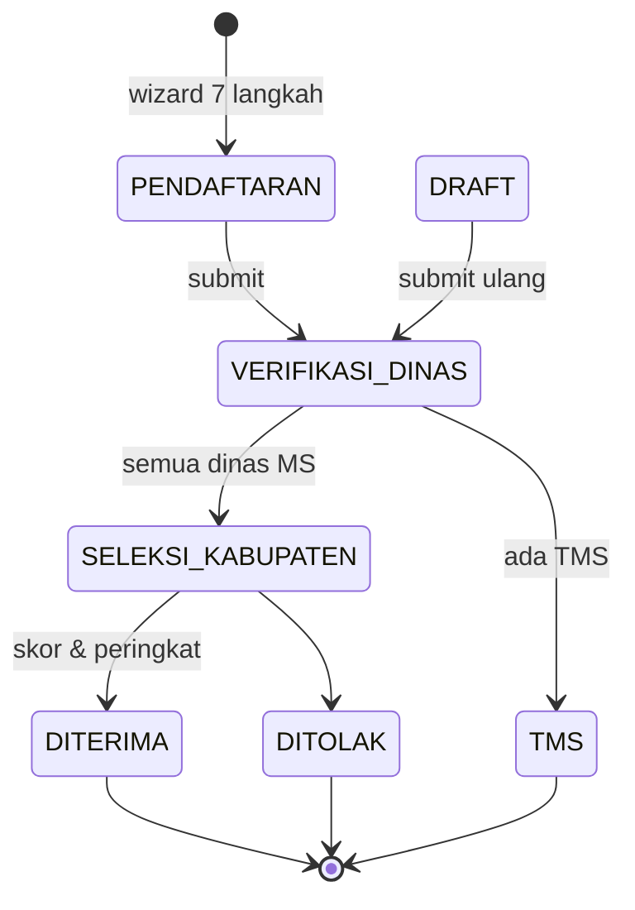

# Workflow Sistem Kartu Hebat Mahasiswa

Sistem beasiswa Kabupaten Murung Raya. Mahasiswa mendaftar, lalu pengajuan diverifikasi lintas dinas (paralel) → seleksi kabupaten hingga hasil dipublikasikan.

## Ringkasan Alur



Diagram teks (ASCII):

```
PENDAFTARAN (wizard 7 langkah)
        │  submit
        ▼
VERIFIKASI_DINAS  (3 dinas paralel untuk semua jalur: Dukcapil, Pendidikan, BKPSDM;
                   + Dinas Sosial khusus jalur Tidak Mampu;
                   + Dinkes khusus jalur Disabilitas;
                   + Parsepor khusus jalur Prestasi)
      │
      ├── ada TMS ─────► TMS
      │
      └── semua MS ────► SELEKSI_KABUPATEN
                              │
                              ├── DITERIMA
                              └── DITOLAK
                                    │
                              PUBLIKASI HASIL
```

## Aktor (Role)

| Role | Tahap | Keputusan |
|---|---|---|
| `mahasiswa` | Pendaftaran | Mengisi wizard & submit |
| `operator_dukcapil` | Lintas Dinas | MS / TMS (paralel) |
| `operator_sosial` | Lintas Dinas (jalur Tidak Mampu saja) | MS / TMS + desil sosial |
| `operator_pendidikan` | Lintas Dinas | MS / TMS |
| `operator_bkpsdm` | Lintas Dinas | MS / TMS |
| `operator_dinkes` | Lintas Dinas (jalur Disabilitas saja) | MS / TMS |
| `operator_parsepor` | Lintas Dinas (jalur Prestasi saja) | MS / TMS |
| `operator_kabupaten` | Seleksi Kabupaten | Pemeringkatan Perbup, export rekap, import keputusan + PDF SK, publikasi |
| `superadmin` | Konfigurasi | Kategori, jenis dokumen, operator |

> **Catatan**: role `operator_desa` dan `operator_kecamatan` masih tersedia di sistem untuk kebutuhan laporan/riwayat, tetapi tidak lagi berperan dalam alur verifikasi. Tahap verifikasi desa & kecamatan sudah dihapus.

## 1. Pendaftaran

Mahasiswa mengisi **wizard 7 langkah**, tersimpan di tabel `pendaftarans`:

1. Data Pribadi
2. Pendidikan (IPK, semester, tahun masuk, akreditasi PT)
3. Prestasi (tingkat dan peringkat juara lomba, serta status kepengurusan inti ormawa universitas)
4. Orang Tua
5. Dokumen
6. Review
7. Submit

Saat submit, `ApplicationWorkflowService::submit()` mengkapsulasi integrasi pendaftaran ke workflow verifikasi:

1. **Resolve wilayah** — memetakan desa/kelurahan ke master `villages` (dengan normalisasi nama wilayah).
2. **Resolve jalur** — menentukan `ApplicationType` dari kategori beasiswa: `AKADEMIK`, `TIDAK_MAMPU`, `DISABILITAS`, `NON_AKADEMIK`.
3. **Sinkronisasi & Inisiasi** — membuat/memperbarui record `Application`, menyalin referensi dokumen, dan mencatat log submit.
4. Memajukan status ke `VERIFIKASI_DINAS` dan menotifikasi operator dinas terkait.

### Validasi sebelum submit

`ApplicationWorkflowService::submit()` menolak jika:

- Bukan milik mahasiswa / periode tidak aktif / status tidak bisa diedit.
- Jalur (`application_type`) belum dipilih.
- Profil belum lengkap.
- IPK kosong untuk jalur `AKADEMIK` / `NON_AKADEMIK`.
- Jalur `NON_AKADEMIK` tanpa minimal satu prestasi.
- Dokumen wajib belum lengkap (dicocokkan per jalur).

## 2. Keputusan Verifikasi (MS / TMS)

Setiap operator dinas memberi **satu keputusan keseluruhan** (MS/TMS) atas aplikasi, **didukung checklist per-berkas** (lihat ADR-0003): tiap dokumen dinilai `memenuhi` / `tidak_memenuhi` per tahap, tersimpan di `document_verifications`.

> **Penting**: Penilaian checklist dokumen bersifat **wajib (mandatory)** sebelum keputusan dikirimkan. Sistem menolak (`assertAllDocumentsVerified`) jika masih ada dokumen wajib yang belum dinilai.

| Keputusan | Arti | Efek |
|---|---|---|
| **MS** (Memenuhi Syarat) | Rekomendasi kelayakan lolos tahap dinas | Status naik (jika seluruh dinas wajib MS) |
| **TMS** (Tidak Memenuhi Syarat) | Final, tidak memenuhi syarat | Status langsung jadi `TMS` |

## 3. Verifikasi Lintas Dinas (paralel)

Inti logika verifikasi dinas dikelola oleh modul mendalam `AgencyVerificationService`:

- Prasyarat status: `VERIFIKASI_DINAS`.
- Dinas Dukcapil, Pendidikan, dan BKPSDM memverifikasi **paralel** untuk semua jalur; **Dinas Sosial hanya untuk jalur TIDAK_MAMPU**, Dinas Kesehatan (**Dinkes**) hanya untuk jalur **DISABILITAS**, dan Dinas **Parsepor** hanya untuk jalur **NON_AKADEMIK** (Prestasi). Masing-masing menyimpan keputusan di `agency_verifications` (kunci: `application_id` + `agency`).
- Jumlah dinas yang wajib memutuskan ditentukan oleh `AgencyVerificationService::requiredAgencies()`: 3 untuk AKADEMIK, 4 untuk TIDAK_MAMPU (termasuk Sosial), 4 untuk DISABILITAS (termasuk Dinkes), dan 4 untuk NON_AKADEMIK (termasuk Parsepor).
- **Status application belum berubah** sampai seluruh dinas yang wajib selesai memutuskan (`return null` selama belum lengkap).
- Saat seluruh dinas wajib telah memutuskan:
  - Ada minimal satu TMS → langsung menjadi `TMS`.
  - Semua dinas memutuskan MS → hitung skor (`SelectionScoringService::calculate`) dan status naik ke `SELEKSI_KABUPATEN`.
- Efek keputusan dinas ke profil mahasiswa:
  - Dukcapil → `status_kependudukan` (`sesuai` / `tidak_sesuai`).
  - Sosial → `desil_sosial` (DTSEN), khusus jalur Tidak Mampu.
  - Pendidikan → rekomendasi kelayakan MS / TMS (kolom `desil_pendidikan` telah dihapus).
  - BKPSDM → rekomendasi kelayakan MS / TMS (semua jalur).
  - Dinkes → rekomendasi kelayakan MS / TMS (khusus jalur Disabilitas).
  - Parsepor → rekomendasi kelayakan MS / TMS (khusus jalur Non-Akademik/Prestasi).

## 4. Alur Perbaikan (draft)

Tidak ada keputusan BTL. Aplikasi yang perlu diperbaiki dikembalikan ke status `DRAFT` (secara administratif), mahasiswa memperbaiki data/dokumen lalu submit ulang — langsung masuk antrean `VERIFIKASI_DINAS` lagi.

Saat mahasiswa submit ulang, `ApplicationWorkflowService::submit()` menyetel status ke `VERIFIKASI_DINAS`. Penilaian dokumen lama dibersihkan (`AgencyVerificationService::resetForApplication`) dan putaran penilaian baru (`round`) dimulai agar dinas menilai berkas dari awal.

## 5. Seleksi, Pemeringkatan Perbup, & Publikasi Hasil

Tahap seleksi kabupaten mengintegrasikan perhitungan skor otomatis, aturan penentuan peringkat resmi sesuai **Peraturan Bupati (Perbup) Murung Raya**, pemilahan kategori **Reguler vs Non-Reguler**, serta alur penetapan SK melalui `SelectionWorkflowService`.

### 5.1. Skoring Awal (Strategy Pattern)

`SelectionScoringService` menghitung skor per jalur memakai Strategy pattern di `app/Services/Scoring/`:

| Jalur | Strategy | Basis |
|---|---|---|
| AKADEMIK | `AcademicScoring` | IPK & semester |
| TIDAK_MAMPU | `DesilScoring` | Desil sosial ekonomi (DTSEN) |
| DISABILITAS | `DisabilityScoring` | IPK, semester, jenis disabilitas |
| NON_AKADEMIK | `PrestasiScoring` | Tingkat & peringkat kejuaraan |

- Skor dihitung: `normalized × weight` per kriteria → `final_score` di `selections`.

### 5.2. Hierarki Pemeringkatan Resmi Perbup (`compareSelections`)

Jika terjadi persaingan nilai antarkandidat, pemeringkatan kabupaten (`recalculateRanking`) diurutkan berdasarkan aturan hierarki prioritas Perbup:

1. **Jalur Tidak Mampu**:
   1. Nilai desil 1 sampai dengan desil 5 pada DTSEN (ASC: desil lebih rendah lebih prioritas).
   2. Nilai IPK kumulatif (DESC).
   3. Tahun angkatan masuk perguruan tinggi yang lebih awal (ASC).
   4. Akreditasi Perguruan Tinggi (DESC: Unggul/A > Baik Sekali/B > Baik/C > lainnya).

2. **Jalur Akademik**:
   1. Nilai Indeks Prestasi Kumulatif (IPK) total/kumulatif (DESC).
   2. Tahun angkatan masuk perguruan tinggi yang lebih awal (ASC).
   3. Akreditasi Perguruan Tinggi (DESC).

3. **Jalur Non-Akademik / Prestasi**:
   1. Tingkatan juara 1, 2, atau 3 kompetisi non-akademik (DESC: Internasional > Nasional > Provinsi > Kab/Kota > Kampus).
   2. Kepengurusan inti organisasi mahasiswa tingkat universitas (DESC: Ketua/Sekretaris/Bendahara ormawa universitas).
   3. Tahun angkatan masuk perguruan tinggi yang lebih awal (ASC).
   4. Akreditasi Perguruan Tinggi (DESC).

4. **Jalur Disabilitas**:
   1. Tahun angkatan masuk perguruan tinggi yang lebih awal (ASC).
   2. Akreditasi Perguruan Tinggi (DESC).

### 5.3. Alur Keputusan Final & Publikasi SK (`SelectionWorkflowService`)

1. **Pemisahan Kategori**: Operator dapat menyaring data berdasarkan kategori **Reguler** dan **Non-Reguler** serta masing-masing jalur beasiswa.
2. **Export Rekap Ranking**: Operator kabupaten mengunduh berkas rekapitulasi Excel (`CandidatesExport`) untuk ditinjau bersama tim seleksi dan diajukan ke pimpinan daerah.
3. **Persetujuan (ACC) & SK Penetapan**: Pimpinan menetapkan daftar penerima beasiswa dalam bentuk Surat Keputusan (SK) resmi.
4. **Import Keputusan & Unggah SK**: Operator mengunggah kembali file Excel keputusan (`SelectionDecisionImport`) yang memuat status akhir penerima, sekaligus melampirkan berkas **PDF SK Penetapan**.
5. **Publikasi Hasil**: Sistem mengeksekusi publikasi inkremental:
   - Kuota dan peringkat dihitung atas seluruh kandidat periode, tetapi hanya kandidat yang `selections.published_at` masih kosong yang ditulis.
   - Status aplikasi kandidat baru diubah menjadi `DITERIMA` atau `DITOLAK`.
   - Mengisi nomor SK, tanggal SK, dan menyimpan path file PDF lampiran SK pada record `announcements`.
   - Mengirim notifikasi kelulusan/penolakan ke akun mahasiswa kandidat baru saja; penerima lama tidak dinotifikasi ulang.
   - Publikasi pertama memakai slug `hasil-seleksi-<periode>`; publikasi perbaikan memakai slug `…-perbaikan-…` dengan SK baru sehingga berkas SK lama tetap dapat diunduh.
   - Bila tidak ada kandidat baru, operator mendapat pesan "Tidak ada hasil baru untuk dipublikasikan".
   - Hasil dapat diakses publik pada halaman pengumuman hasil seleksi (`public.results`).

## 6. Pencatatan & Notifikasi

- Setiap transisi dicatat di `verification_logs` (from/to status, action, actor, notes, metadata).
- Notifikasi (`ApplicationStatusChanged`) dikirim ke mahasiswa dan operator tahap berikutnya (berdasarkan role + wilayah).

## Status Lengkap (`ApplicationStatus`)

| Status | Keterangan |
|---|---|
| `DRAFT` | Belum dikirim / dikembalikan untuk diperbaiki |
| `VERIFIKASI_DINAS` | Antrean verifikasi lintas dinas (3 dinas paralel; +Sosial utk Tidak Mampu, +Dinkes/Parsepor utk Disabilitas/Prestasi) |
| `SELEKSI_KABUPATEN` | Seleksi kabupaten (skoring & peringkat) |
| `TMS` | Final — tidak memenuhi syarat |
| `DITERIMA` | Final — diterima |
| `DITOLAK` | Final — ditolak |

## File Kunci

| File | Peran |
|---|---|
| `app/Services/ApplicationWorkflowService.php` | Orkestrator submit pendaftaran dan sinkronisasi data ke aplikasi |
| `app/Services/AgencyVerificationService.php` | Mesin verifikasi lintas dinas, penegakan checklist berkas, putaran (round), dan mutasi data profil |
| `app/Services/SelectionScoringService.php` | Perhitungan bobot skor dan pemeringkatan seleksi resmi Perbup |
| `app/Services/SelectionWorkflowService.php` | Workflow seleksi kabupaten: export-import Excel keputusan dan publikasi resmi berlampiran SK |
| `app/Services/Scoring/*` | Strategy skoring per jalur |
| `app/Exports/CandidatesExport.php` | Export rekap peringkat kandidat ke format Excel |
| `app/Imports/SelectionDecisionImport.php` | Import berkas keputusan penetapan hasil seleksi dari Excel |
| `app/Enums/ApplicationStatus.php` | Status + label + progres + flag |
| `app/Enums/VerificationDecision.php` | MS / TMS |
| `app/Enums/ApplicationType.php` | Jalur seleksi + mapping strategy |
| `app/Enums/UserRole.php` | Role aktor |
| `app/Models/Application.php` | Work record pengajuan beasiswa |
